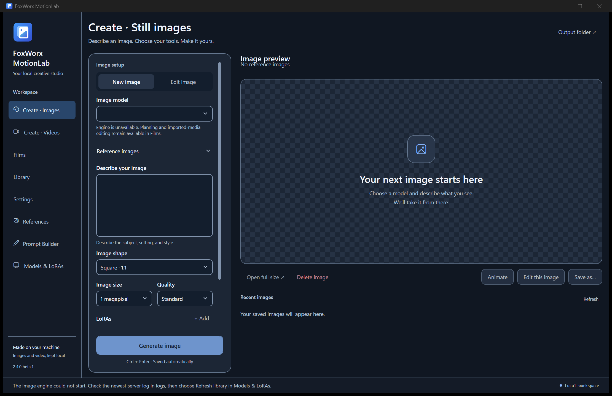

# FoxWorx MotionLab

**A local Windows workspace for images, video and multi-shot projects.**

*Actual screenshot of the published Windows beta, captured from a fresh, empty workspace. No engine or model pack is installed in this screenshot, so generation is unavailable. No generated-media sample or personal project is shown.*

## Download the Windows beta

[**Get FoxWorx MotionLab 2.4.0 beta 1**](https://github.com/Lipton1010/foxworx-motionlab/releases/tag/v2.4.0-beta.1)

Choose the unsigned self-extracting EXE (95.2 MB) or ZIP (136.8 MB). Verify the release's `SHA256SUMS.txt` before opening it. This is an experimental **Windows x64 prerelease**, not a stable release or a promise of compatibility with every GPU.

1. Extract into a **new local folder** with write permission. Do not overwrite an existing workspace.
2. Open **Setup.cmd**. Inspect your machine and review download sizes, estimated memory requirements and component/model terms.
3. Choose only the optional packs you need, then open **Start Image Studio.cmd**.

The core includes the desktop workspace and planning/imported-media tools. **Model weights, the generation engine and FFmpeg are not bundled.** Engine, model, prompt-refiner and media-tool downloads are separate choices. Windows may display warnings because the beta is unsigned.

Existing technical executable names and workspace paths retain **Image Studio** for compatibility. The app's display name is **FoxWorx MotionLab**. No personal drive layout or existing developer Python installation is required by the portable release.

## Create and organize

- **Images:** prompt-based generation, plus supported reference-image editing.
- **Videos:** text-to-video or a supported first frame, with preview and save controls.
- **Films:** plan shots, work with imported media and keep project settings together.
- **Library and references:** review local outputs and manage supported model/LoRA choices.
- **Prompt refinement:** optionally draft a better prompt, review it before applying, and undo changes.

Generation requires the corresponding engine and compatible model files. Missing models remain unavailable rather than silently switching your choice. Local project metadata and outputs stay in your workspace; optional downloads contact their named upstream hosts.

## Optional models and hardware

The app has workflow integrations for **Qwen Image 2.1**, **Krea 2 Raw**, **MOSS Image Base**, **LTX 2.5**, and **MiniMax H3**. Availability depends on the installed files and supported workflow. An integration is not evidence that its weights ship in the installer or that every setting has been validated.

Use setup's machine check and per-pack download/terms information before installing. RAM, VRAM and disk admission figures are **estimates**, not benchmark-certified universal minimums. Free memory, image size, frame count, context and other running applications affect whether a job fits. No physical smaller-GPU compatibility claim is made from an RTX 4090 test.

Local H3 supports the app's text-to-video and first-frame workflows. It does not implement the hosted service's complete Context-IR or multimodal-reference feature set.

## Optional local prompt refinement

The beta uses an independent **Qwen3.5 4B/9B** adapter and versioned guidance for the selected image/video model and mode. The former Qwen Image 2.1 PE implementation and its prompts are not used or bundled in this release's core.

- 4B text and one synthetic-image smoke test passed on **RTX 4090 24 GB**.
- 9B is an optional candidate, **not benchmark-validated here**.
- The refiner is unloaded before generation resumes. Manual prompts remain usable without it.
- Review the result. Refinement is not a guarantee of prompt fidelity or generation quality.

See [prompt refinement details](portable/PROMPT%20REFINEMENT.txt) for estimated headroom, profile customization and test limitations. Choosing a permissively licensed refiner does not change the license of the image/video model.

## Media tools and licenses

FFmpeg is a separate, explicit-consent upstream download for workflows that require media encoding. It is not included in the core archive. Component license notices and any applicable distribution obligations remain separate from the app's license.

Original application code is licensed under [Apache-2.0](LICENSE). See [NOTICE](NOTICE). Every model, runtime and third-party component retains its own terms, including restrictions on commercial use where applicable. The app license does not grant rights to reference images, voices, music or other media, or provide general codec-patent clearance.

## What was tested

The exact published package passed fresh isolated extraction, embedded checksums, CPU project/helper persistence, graph-host checks and six native-window/UI checks on the development Windows machine. Additional automated checks are listed in the [release notes](https://github.com/Lipton1010/foxworx-motionlab/releases/tag/v2.4.0-beta.1).

**Not certified:** pristine Windows VM installation, in-place production upgrades, 9B refinement, physical smaller GPUs, or complete generation for every model and setting. Preserve existing projects and model libraries. This beta is intended for cautious testing.

For development and advanced multi-shot workflows, see [production notes](desktop/PRODUCTION.md). Historical development measurements in those notes are not portable-installation requirements.
